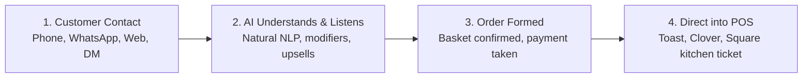

# CallAutomate for Restaurants — Complete Knowledge Base

> **Official Knowledge Base & Platform Documentation**  
> *Last Updated: October 2026*  
> *Website: [https://callautomate.ai](https://callautomate.ai)*  
> *Support Email: [support@callautomate.ai](mailto:support@callautomate.ai)*  
> *Phone / WhatsApp: [+353-61-555-222](tel:+35361555222)*

---

## 1. Executive Summary & Brand Positioning

**CallAutomate** is an AI-powered conversational ordering and voice automation platform built specifically for restaurants, pizzerias, cafes, bars, and hospitality venues.

### Core Value Proposition
> **"Every call answered. Every order in your POS."**

Traditional restaurant operations lose thousands in revenue every month due to missed phone calls, unanswered social media direct messages, overwhelmed front-of-house staff during peak dinner rushes, and excessive 20–30% commission fees charged by third-party delivery marketplaces (DoorDash, Uber Eats, Just Eat).

CallAutomate solves this by deploying **natural-sounding AI voice agents, WhatsApp chatbots, AI-driven web ordering, and Meta (Instagram/Facebook) chatbots** that answer instantly, understand complex restaurant orders, handle modifiers and allergies, and inject order tickets directly into the restaurant’s existing Point of Sale (POS) system without any human intervention.

---

## 2. Core Products & Ordering Suite

CallAutomate offers four primary channels that can be deployed individually or as an unified, synchronized omnichannel ordering suite:

| Product Channel | Primary Function | Key Business Impact |
| :--- | :--- | :--- |
| **1. AI Voice Agent** | Picks up incoming phone calls on the 1st ring, takes natural voice orders, upsells items, and syncs directly with the POS. | Eliminates busy signals, zero callers on hold, captures 100% of phone orders during peak rushes. |
| **2. WhatsApp Chatbot** | Conversational chat ordering via WhatsApp with interactive quick-reply buttons and secure payment links. | Customers order "like texting a friend"; automates customer re-orders and sends automated prep updates. |
| **3. AI Ordering Website** | Custom branded direct ordering storefront (`restaurant.com/order`) with an interactive AI assistant. | Zero third-party marketplace commissions; customers type or tap and the basket auto-fills. |
| **4. Meta Chatbot** | 24/7 automated ordering and customer service in Instagram Direct Messages and Facebook Messenger. | Converts social media followers and late-night DM inquiries into paid, kitchen-ready orders. |

---

### Detailed Product Specifications

### 📞 1. AI Voice Agent (`#p-voice`)
* **Natural Voice Conversation**: Speaks in human-like, natural tone; pauses, listens, and responds without robotic delays or frustrating touch-tone IVR trees.
* **Complex Modifier & Allergen Handling**: Handles substitutions, toppings, size variants, gluten-free/vegan requests, and preparation notes (e.g., *"Large Pepperoni with extra crispy crust, half olives, no jalapeños"*).
* **Automated Upselling**: Intelligently recommends high-margin add-ons, dipping sauces, sides, desserts, and beverage pairings.
* **Unlimited Concurrent Lines**: Answers 10, 20, or more phone calls simultaneously. During the peak Friday 7:00 PM rush, zero customers receive a busy tone or hold music.
* **Direct POS & Kitchen Printing**: Upon customer confirmation, the order ticket and payment status land instantly on the POS and kitchen display unit.
* **Seamless Staff Handover**: If a caller explicitly asks for a human manager or asks questions outside the restaurant's operational scope, the agent immediately transfers the call to on-duty staff.

---

### 💬 2. WhatsApp Chatbot (`#p-wa`)
* **Conversational Basket Building**: Customers chat naturally via WhatsApp to view menus, customize dishes, and place orders.
* **Interactive Menus & Quick-Replies**: Features tap-to-select buttons for items, sizes, and pickup vs. delivery choices.
* **Secure Payment Links**: Automatically generates secure checkout and mobile payment links (Stripe / digital wallets).
* **Automated Order Tracking**: Sends live status updates directly in the chat thread (*"Order #1044 received"*, *"Kitchen is preparing your pizza"*, *"Ready for pickup in 15 mins"*).
* **Smart Team Handover**: Staff can intervene in the chat thread at any moment if special assistance is required.

---

### 🌐 3. AI Ordering Website (`#p-web`)
* **Direct, Commission-Free Storefront**: Gives restaurants their own modern, branded ordering URL (e.g., `tonyspizzeria.com/order`).
* **Interactive AI Assistant**: An intelligent sidebar chat allows customers to type or speak natural requests (*"Add two Margheritas and a garlic bread"*), automatically adding matching items to their checkout cart.
* **Live Menu Synchronization**: Real-time integration with the POS ensures out-of-stock (86'd) items and dynamic pricing are reflected instantly.
* **Zero Marketplace Fees**: Restaurants keep 100% of their revenue without giving up 20%–30% cuts to delivery aggregators.

---

### 📸 4. Meta Chatbot (`#p-meta`)
* **Instagram DMs & Facebook Messenger**: Connects directly to the restaurant's Instagram and Facebook business profiles.
* **24/7 Instant Responses**: Answers frequently asked questions (opening hours, address, parking, gluten-free options, catering inquiries) within seconds, even at 2:00 AM.
* **Social Commerce Conversion**: Converts profile traffic and story replies directly into placed orders without forcing customers to leave their favorite social apps.
* **Centralized Menu Rules**: Enforces the exact same pricing, modifiers, and store hours as all other ordering channels.

---

## 3. How It Works: The 4-Step Operational Flow

1. **Step 1: The Phone Rings or Message Arrives**  
   A customer calls the restaurant’s existing phone number, sends a WhatsApp message, visits the website, or sends an Instagram DM.
2. **Step 2: AI Answers and Listens**  
   CallAutomate answers on the first ring with zero latency. It greets the customer using the restaurant’s custom voice and persona, listens to the order, handles customization, and suggests upsells.
3. **Step 3: The Order is Confirmed**  
   The AI reviews order accuracy with the customer, verifies contact details, and collects payment or marks for counter pickup/delivery.
4. **Step 4: Sent Directly to Your POS**  
   The order ticket is transmitted straight to the POS (Toast, Clover, Square, etc.) and prints out on the kitchen line printer. Zero staff time required.

---

## 4. Point of Sale (POS) & Technical Integrations

CallAutomate connects natively into industry-standard hospitality Point of Sale systems:

* **Toast POS** (Full bi-directional menu sync, modifier mapping, and ticket firing)
* **Clover** (Real-time order creation, inventory sync, kitchen receipt routing)
* **Square** (Automated catalog ingestion, payment confirmation, order tracking)
* **Lightspeed Restaurant**
* **Revel Systems**
* **Epos Now**
* **Custom / Legacy POS Systems** (API connectors and thermal printer integrations)

### Telephony Setup
* **Keep Your Existing Phone Number**: Restaurants do **not** need a new phone number. CallAutomate integrates with existing landlines and VoIP providers using standard carrier call-forwarding or SIP routing.
* **Fail-Safe Redundancy**: If internet connectivity is interrupted at the store, calls can automatically fall back to physical restaurant staff lines.

---

## 5. Financial Model & Return on Investment (ROI)

### The Cost of Missed Calls
Independent hospitality data shows that **up to 30% of incoming restaurant calls go unanswered** during dinner rushes, weekend peaks, and prep hours.

The website features an interactive **ROI Calculator** based on actual restaurant operating metrics:

$$\text{Monthly Recovered Revenue} = (\text{Weekly Missed Calls} \times 4.333) \times \text{Ordering Intent \%} \times \text{Average Order Value (AOV)}$$

#### Standard Scenario Benchmarks:
* **Weekly Missed Calls**: 40 calls
* **Average Order Value (AOV)**: €28.00 / $30.00
* **Ordering Intent**: 60% of callers intended to order food
* **Calculated Results**:
  * **Recovered Orders**: ~104 orders / month
  * **Monthly Recovered Revenue**: **€2,912 / month**
  * **Annual Recovered Revenue**: **€34,944 / year**

### Direct Orders vs. Delivery Aggregators
* **Third-Party Marketplaces (DoorDash / UberEats / JustEat)**: Charge **20% to 30% commission** per ticket and own customer data.
* **CallAutomate Direct Channels**: **0% marketplace commissions**, allowing restaurants to retain their margins and build direct customer loyalty databases.

---

## 6. Pricing & Commercial Model

* **Modular Adoption**: Restaurants can begin with a single channel (e.g., AI Voice Agent only or WhatsApp Chatbot only) and add additional channels as their volume increases.
* **Volume-Tailored Pricing**: Structured based on weekly call volume, menu item complexity, and POS integration requirements.
* **No Long-Term Lock-in**: Designed around transparent subscriptions that pay for themselves within the first few recovered orders each month.
* **Free 20-Minute Tailored Demo**: New restaurants receive a personalized demonstration with their actual menu and POS integration configured before making any commitment.

---

## 7. Frequently Asked Questions (FAQ)

### Q: How long does setup take?
**A:** Most restaurants are fully live within a few days. Setup depends on menu size and POS platform. The CallAutomate engineering team handles complete menu transcription, voice tuning, modifier setup, and POS connection testing.

### Q: Which POS systems do you connect to?
**A:** Toast, Clover, and Square are our core native integrations. We also support Lightspeed, Revel, Epos Now, and custom integrations.

### Q: What if a customer wants to speak with a real person?
**A:** The agent can immediately pass the call or chat to your on-duty staff whenever a customer requests a human, or whenever an inquiry falls outside the AI's configured knowledge boundaries.

### Q: Do I need a new phone number?
**A:** No. CallAutomate works directly with your existing restaurant phone number so loyal customers continue dialing the number they already know.

### Q: Can I start with just one channel?
**A:** Yes. Many restaurant owners launch with the AI Voice Agent or WhatsApp Chatbot first, and expand to the AI Ordering Website and Meta Chatbot as they see results.

---

## 8. Head-to-Head Comparison

| Feature / Metric | Traditional Phone Staff | Generic Phone IVR ("Press 1") | 3rd-Party Delivery Apps | CallAutomate AI Suite |
| :--- | :--- | :--- | :--- | :--- |
| **Pickup Speed** | Misses calls during rush | Slow, frustrating trees | N/A (App only) | **1st Ring (Instant)** |
| **Simultaneous Calls** | 1 call per employee | Limited line capacity | N/A | **Unlimited lines concurrently** |
| **Commission Fees** | High labor payroll costs | High monthly PBX cost | **20% – 30% per order** | **0% commission** |
| **Order Accuracy** | Prone to background noise errors | Can't take food orders | High app errors | **POS-verified menu modifiers** |
| **POS Direct Entry** | Staff must manually re-type | None | Requires tablet re-typing | **Direct automatic injection** |
| **Operating Hours** | Store hours only | Recorded message | App hours | **24/7 Voice & Chat availability** |

---

## 9. Contact Information & Support

### Support & Operations
* **Primary Support Email**: [support@callautomate.ai](mailto:support@callautomate.ai)
* **Direct Phone Line**: [+353-61-555-222](tel:+35361555222)
* **WhatsApp Hotline**: [+353-61-555-222](https://wa.me/35361555222)
* **Monitoring & Support Hours**: **24/7 Voice Monitoring & Technical Support**

### Booking a 20-Minute Demo
Prospective restaurants can book directly through the interactive scheduling portal on the website:
1. **Step 1: Contact Details** (Name, Restaurant Name, Phone or Email).
2. **Step 2: Setup Preferences** (Channels of interest, POS selection, notes).
3. **Step 3: Preferred Date & Time** (Real-time local timezone booking with instant Google Calendar sync).
4. **Instant Notification**: System automatically delivers a rich, branded email alert to `support@callautomate.ai` with all submitted details and customer reply links via secure Hostinger SMTP.

---

## 10. Technical Architecture & Environment Configuration

### Application Stack
* **Framework**: Next.js 16 (App Router) + React 19 + TypeScript
* **Styling**: Vanilla CSS design system ([globals.css](src/app/globals.css)) with brand gradients (`#0b0e1a` dark blue, `#2e73ed` CallAutomate blue accents)
* **Hosting**: Vercel Serverless Edge Platform
* **Audio & Visuals**: Three.js WebGL interactive audio orb + synthetic voice playback demos
* **Email Infrastructure**: Nodemailer via Hostinger Secure SMTP (`smtp.hostinger.com:465 SSL`)
